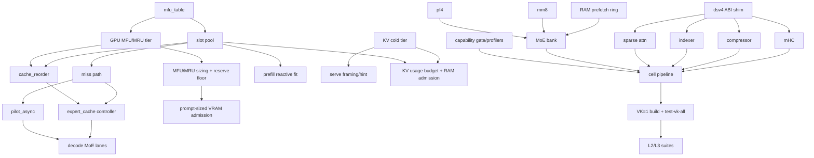

# B — Fork inventory: `colibri-ds4-vulkan` vs merge-base `dd7df2c`

Scope: 353 non-merge commits, `git diff --stat dd7df2c..HEAD` = **318 files, +124,595 / −3,653**.
Merge-base `dd7df2c` (2026-08-24) = `git merge-base dd7df2c upstream/dev`; `upstream/dev`
(`5d56c05a`) is **~+1,100 commits** ahead of it and — crucially — **has since grown its own
DeepSeek-V4 Vulkan path** (see §0). Evidence pointers are to in-tree docs, not re-derived here.

## 0. The single most important finding

`upstream/dev` now contains a *different, more general* V4/GPU architecture that did not exist at
`dd7df2c`:

| upstream artifact | lines | what it is |
|---|---|---|
| `c/vk_chain.c` / `vk_chain.h` | 2821 | one-frame dense+attention chain, `COLI_VK_CHAIN_*` |
| `c/vk_dmoe.h` | (header) | device-side routed MoE inside the chain, no host step |
| `c/vk_tier.c` / `vk_tier.h` | 2123 | generic VRAM expert tier: `.coli_usage`-ranked fill, LFRU margin, async upload, 2nd device, RAM/VRAM exclusivity |
| `c/shaders/chain_dsv4.comp` | 561 | V4 attention/compressor/indexer/top-k/rope, 10 modes |
| `c/shaders/chain_mhc.comp`, `c/dsv4_mhc.h` | 118 / 60 | device mHC + CPU reference mHC |
| `c/shaders/chain_dsa.comp`, `sparse_attn.h`, `sparse_index.h` | 249 / 122 / 242 | DSA attention, CPU sparse-attend, k-pooled indexer |
| `c/kv_persist.h`, `kv_prefix.h`, `serve_budget.h` | 252 / 149 / 21 | disk KV persistence, prefix reuse, serve budget |

Consequence: the fork's **op-surface shaders are functionally duplicated upstream in a different
decomposition** (fork = host-stepped discrete shaders + explicit cell pipeline; upstream = one
fused chain). Porting must therefore be *per-capability value*, not *per-file*. The fork's V4
tier is ~16.7 k added lines in `c/backend_vulkan.c` + 5.4 k in `c/backend_vulkan_dsv4.c` + ~15 k in
`c/deepseek_v4.c`; upstream's answers to most of those shaders are one shader + one chain driver.

## 1. CPU / engine & storage

| id | capability | what it does | primary surface (LOC) | knobs / defaults | upstream/dev | class | deps | risk |
|---|---|---|---|---|---|---|---|---|
| **C1** | MFU popularity table | persistent per-(layer,expert) access counts in `<model>/.coli_mfu`, rank/cutoff, decay | `c/mfu_table.c` 147, `.h` 150 | `COLI_DSV4_VK_MFU_DECAY_SHIFT` 0, `_MFU_CUTOFF` 0=auto | **partial** — `vk_tier.c` ranks from `.coli_usage` (route_trace.h), no persistent table/cutoff | DROP-IN MODULE | none | L |
| **C2** | CPU slot pool | fixed-slab RAM expert pool, FREE/MRU/MFU tiers, victim pick, retire/trim to OS | `c/expert_slot_pool.c` 285 | sizing from runtime plan | **partial** — upstream keeps the engine's own RAM expert cache, no tier/slab pool | DROP-IN MODULE | C1 | L |
| **C3** | Miss path | in-place slab load, claim policy (pilot = never-MFU; demand = controller direction, `miss_demand_claim`) | `c/miss_path.c` 101 | — | **none** | DROP-IN MODULE | C1,C2 | L |
| **C4** | Cache controller | classify/compute/update; single-mutator, frozen-tier, no mid-request demote | `c/expert_cache.c` 281, `.h` 223 | — | **none** (upstream tier evicts continuously) | DROP-IN MODULE + engine wiring | C1–C3,C6 | M |
| **C5** | Reorder + adaptive MFU/MRU split | request-boundary quiescent pass: rank, cutoff, split step/dead-zone, hysteresis, stats reset | `c/cache_reorder.c` 466 | `SPLIT_STEP` 5, `SPLIT_DEADZONE` 2, `REBALANCE_PCT` 100 | **none** | DROP-IN MODULE | C1–C4,C6 | M |
| **C6** | GPU-MFU/MRU VRAM tier | frozen VRAM overlay on dual-resident RAM twin, promote ring (append-only), `shed_bytes(gap)`, MFU+MRU sections | `c/gpu_mfu_cache.c` 527 | `MRU_GPU_SHARE` 25, `PROMOTE_PER_TOKEN` 2 (0 warm-boot), `PROMOTE_MB_LAYER` 0, `MFU_GPU_RESERVE_GB` 1.0 | **partial** — `vk_tier.c` is a VRAM tier with LFRU + async fill, but *no* dual residency, no MFU/MRU split, no promote ring, no gap-exact shed | DROP-IN MODULE | C1,C4 | M |
| **C7** | MFU/MRU VRAM sizing + reserve floor | derive tier size from free-VRAM probe (sysfs + `VK_EXT_memory_budget`, smaller wins), reserve floored at admission need + 512 MiB | `c/gpu_mfu_cache.c`, `deepseek_v4.c` `v4_cache_reserve_effective`, `c/tests/test_vk_mfu_probe.c` | `MFU_FREE_MB`/`_FILE`/`_PROBE` (test injection) | **partial** — upstream sizes from budget minus reserve, no admission floor | CONFIG/POLICY + module | C6 | M |
| **C8** | KV cold tier (disk as system of record) | content-addressed `<model>/.coli_ckpt/kv_<fp>_<idhash>.bin`, RAM catalog (ids only), streaming store/restore per layer, pinned system prefixes, LRU+byte GC, cancelled-prefill demote, fingerprint = config+sliding_window+weights identity | `c/deepseek_v4.c` ~24329–25000 (~1.2 k); `PLAN_kv_cold.md` | `V4_PREFIX_CKPT` 1, `_MIN` 512 (WIP→64), `_SLOTS` 32, `_DISK` 2, `_DISK_GB` 8 | **partial** — upstream `deepseek_v4.c:15236-15298` has 8 in-memory slots + `ckpt_<fp>_<n>.bin` disk slots, but index-keyed, no catalog/matching by ids, no streaming, no byte GC, no demote-on-cancel | ENGINE SURGERY (contained) | C9 | M |
| **C9** | Serve framing / capture triggers | 8th `SUBMIT` header field (gateway hint), LCP discovery, prompt-end + cancelled-segment captures | `c/deepseek_v4.c`, `c/openai_server.py`, `docs/serve_protocol.md` | — | **partial** — upstream has the hint plumbing (`deepseek_v4.c:15652`) and prefix captures | ENGINE SURGERY | C8 | M |
| **C10** | KV usage budget + RAM admission | per-request projection (`v4_request_kv_delta` + `capture_bytes`), `RAM_LIMIT_EXCEEDED`→503, RSS-vs-model guard, baseline-derived boot plan (`V4_KV_BASELINE_TOKENS` 65536) | `deepseek_v4.c:24987`, PLAN_kv_usage_budget (archived) | `V4_KV_BASELINE_TOKENS` 65536 | **none** | ENGINE SURGERY | C2,C8 | M |
| **C11** | Prompt-sized VRAM admission | `v4_request_vram_delta` projects this request's compressed-mirror growth; admission sheds exactly the gap (`gpu_mfu_cache_shed_bytes`) and re-verifies ≥90 % reclaim | `deepseek_v4.c:25104-25190` | `MFU_FREE_*` injections | **none** | ENGINE SURGERY | C6,C7 | M |
| **C12** | Prefill reactive fit | `v4_prefill_live_free` (MemAvailable − max(2 GiB,12.5 %)), shed-pool-for-segment, mid-prefill re-fit, OOM recovery to 64-row floor | `deepseek_v4.c:25190-25280` | `V4_PREFILL_SEGMENT` 4096 | **none** | ENGINE SURGERY | C2 | M |
| **C13** | Decode MoE demand lanes | per-layer k misses as read+compute jobs on the PILOT lane pool, single fail-closed join in selection order (byte-identical) | engine glue in `deepseek_v4.c` + `pilot_async.c` | `MOE_LANES` 6 | **none** | ENGINE SURGERY | C3,C14 | M |
| **C14** | Async PILOT lanes | dedicated lane pool (slab fill only), claim/flip/harvest stay on decode thread | `c/pilot_async.c` 433, `.h` 244 | `PILOT_ASYNC` 1, `_LANES` 4, `MAX_INFLIGHT` 12, `WAIT_MS` 75 | **none** | DROP-IN MODULE | C2,C3 | L |
| **C15** | Host-RAM next-layer prefetch ring | while layer L computes, pread layer L+1's whole 256-expert set into an mmap'd ring; upload at switch | `c/deepseek_v4_ram_prefetch.h` 75 + engine glue | `COLI_CUDA_MOE_RAM` 1, `_RAM_MIN` 512 | **none** | ENGINE SURGERY (bank-coupled) | V6 | M |
| **C16** | Rationale: RAM/environment docs | `docs/ENVIRONMENT.md` fork sections, `SETTINGS.md` | — | — | n/a | DOCS | — | — |

Measured evidence (pointers): C4/C5/C6 — REVIEW.md 2026-09-07/2026-10-01/2026-10-18 entries
(matched-capacity 50-prompt campaign: adapt 75.0 % hit vs freq 70.3 / rec 72.8; decode
1.20 vs 1.09/1.08 tok/s). C7/C11 — REVIEW 2026-10-16 (serve 503 wedge; `reserve=1.5GiB`, tier
840→772). C8/C9 — REVIEW 2026-10-16/18 (`hit prefix=379`, TTFT 37.9 s vs 66.5 s). C10 —
REVIEW 2026-09-07 (boot target_slots 24→35 @512K). C12 — REVIEW 2026-10-12 (OOM post-mortem).
C13 — REVIEW G15 (decode 0.92→1.10–1.19 tok/s, +23 %). C14 — REVIEW G14 (−35 % blocking, wall parity).
C15 — REVIEW 2026-09-06 (TTFT −9.6 % @4.1k, −5.3 % @8.8k, byte parity).

## 2. Vulkan backend & shaders

Fork: 51 `.comp` / 62 `.spv`; upstream: 47 `.comp` / 46 `.spv`. Fork `c/backend_vulkan.c`
7,144 → 23,837 lines; `c/backend_vulkan_dsv4.c` 5,433 new (the `dsv4_cuda_*` ABI shim, 81 symbols,
`c/dsv4.def` +2 exports).

| id | capability | what it does | primary surface / shaders | knobs | upstream/dev | class | deps | risk |
|---|---|---|---|---|---|---|---|---|
| **V1** | dsv4 ABI shim | same-named-ABI + guarded include swap so engine call sites are unchanged; link-time fail-fast on new calls | `backend_vulkan_dsv4.c/.h`, `dsv4.def` | — | **none** (upstream drives V4 through `vk_chain`/`vk_dmoe`) | ENGINE SURGERY | — | M |
| **V2** | mHC residency + fusion | Sinkhorn/pre/post stay VRAM-resident (T1b); decode pre/post as one dispatch; batch pre_fused | `mhc_*.comp` ×8 (+8 spv), `backend_vulkan.c` mHC section | `MHC_DECFUSE` 1, `MHC_DECFUSE_POST` 1 | **partial** — `chain_mhc.comp` + `dsv4_mhc.h` CPU ref; no residency tags, no dec-fuse kernels | SHADER-ONLY + engine | V1 | M |
| **V3** | Compressor | resident rolling-group pool + scan (serial & parallel 2-pass, f16 variant, fp32-tree opt-in) | `comp_scan.comp`, `comp_scan_par.comp`, `c/shaders/*_f16.spv` | `COLI_DSV4_VK_COMP_SYS` 0, `COMP_FP32` 0, `PAR_COMP` (retired) | **partial** — `chain_dsv4.comp` mode 2 | SHADER-ONLY | V10 | M |
| **V4** | DSA indexer | prep, projection (fp8 replica), scoring (register & LDS-tiled, f16 key pool), selection v1/v2 (bitonic phase-1 fix), deferred train | `idxprep/idxproj/idxscore/idxscore_tiled/idxsel/idxsel2.comp` | `IDXSCORE_TILED` on, `IDXPOOL_F16` (retired) | **partial** — `chain_dsv4.comp` modes 3–5, `sparse_index.h` (CPU, k-pooled) | SHADER-ONLY | V10 | M (bit-identity vs CPU is load-bearing) |
| **V5** | Sparse attention | MQA over window-ring + compressed rows, sink; flash-attention variant + Br=2 decode tile | `sparse_attn.comp`, `sparse_attn_fa.comp` (+`_dec`, `_f16`) | `ATTN_FA` 1, `ATTN_DEC_TILE` 1, `ATTN_SEG` 1 | **partial** — `chain_dsv4.comp` mode 0 + `sparse_attn.h` | SHADER-ONLY | V10 | M |
| **V6** | MoE group / bank | fused single-submit decode group, whole-chunk fused prefill bank (expert-major + grouped + descriptor cache), on-device swiglu/merge | `moe_swiglu/moe_merge/moe_reduce/wo_gather/wo_in_gather.comp`, bank in `backend_vulkan.c` | `FUSED_MOE` (retired, hardwired), `BANK_DESC_CACHE` 1 | **partial** — `vk_dmoe.h` + `qmatmul_grp*` + `chain_moe*` do device MoE; no fused swiglu chain, no bank | SHADER-ONLY + engine | V1,V7,V8 | H (bank is ~3 k lines of coupled code) |
| **V7** | mm8 GEMM family | S>1 MM8 kernels (f/m/s/m16), bf16 variant, split-K + reduce, fill target 2048 | `qmatmul_mm8*.comp`, `qmatmul_mm8_reduce.comp` | `MM8_SPLITK` 1(2048), `MM8_VARIANT` auto | **none** (no mm8 symbol in upstream `backend_vulkan.h`) | SHADER-ONLY | V1 | M |
| **V8** | fp4/pf4 family | packed-fp16, i8-act, pair, ts4, id, s1 gemv/s1 grouped variants of the e2m1 expert GEMM | `qmatmul_pf4*.comp` (8 kernels), `qmatmul_s1_fp4/sp1g` | `PF4_F16` 1, `PF4_WAVE` 64, `EXPERT_S1GEMV` 1, `WO_S1G` 1 | **partial** — e2m1 decode exists in upstream `backend_vulkan.c`; the pf4 kernel family does not | SHADER-ONLY | V6 | M |
| **V9** | Cell / submit pipeline | one-submit prefill cell: prologue → glue2 → idxprep/score/sel → attn → glue3 → wq_b → wo joined (`cell_join_commit`), mHC tail merge, queue-ahead (pending fence), CB-session guard, dec2 decode chain, FFN opener/tail, `kv_ring_append` | `glue1/2/3/glue_qn_rope/dec_*/bf16r/kv_ring_append.comp`, `PLAN_submit_merge.md`, `PLAN_device_queues.md` | `CELL_TAIL` 1, `QUEUE_AHEAD` 1, `CB_SESSION` 1 (strict) | **partial** — upstream's chain is one frame for the whole forward (`COLI_VK_CHAIN_*`), so it already has fewer fences but no cell/module granularity | ENGINE SURGERY | V1,V2–V8 | H |
| **V10** | Backend hygiene | `coli_vk_capability()` strict-fatal degradation gate (52 sites), ts profiler (`COLI_VK_TS_PROF` 1–3), host prof, arena log | `backend_vulkan.c` | `STRICT` 1, `TS_PROF` 0, `SPIN_US` 300 | **partial** — upstream has no capability gate; has memory-budget probing | ENGINE SURGERY (self-contained) | — | L |
| **V11** | Secondary device tier | second device experts (`DEV2`) | `backend_vulkan.c` | `DEV2` auto, `EXPERTS2` 512, `RESERVE2_GB` 0.5 | **full** — upstream `tk_tier`/`COLI_VK_DEV2`/`COLI_VK_EXPERTS2`/`COLI_VK_RESERVE2_GB` | — | — | — |
| **V12** | Support shaders | QDQ (arith e4m3 decode), qdq_gather/id, quant_q8, rmsnorm, bf16r, attention_absorb | 6 `.comp` | `QPREP` 1, `OPS` group mask | mostly **full** upstream (`qdq`/`qmatmul`/`rmsnorm` shared) | SHADER-ONLY | — | L |

## 3. Build / test / tooling

| id | capability | surface | upstream | class |
|---|---|---|---|---|
| **T1** | `Makefile.deepseek-v4` VK tier | `VK=1` build, 40-target `VK_L2_TARGETS`, `test-vk-all` aggregate, `verify-vk-l2-targets` completeness gate, `VK=0` byte-parity guard | none | DOCS/TEST |
| **T2** | L2/L3 suites | 44 new `c/tests/test_dsv4_*.c` (~16 k lines), `vk_envelope.h`, stage oracle (`tests/test_dsv4_vk_stage_oracle.c`, `c/tools/dsv4_stage_oracle_pack.py`) | none | DOCS/TEST |
| **T3** | Cache/storage suites | `test_mfu_table`, `test_slot_pool`, `test_gpu_mfu_cache`, `test_miss_path`, `test_expert_cache`, `test_cache_reorder`, `test_cache_parity`, `test_prefill_cache`, `test_pilot_async(+tsan)`, `test_v4_ram_prefetch` | none | DOCS/TEST |
| **T4** | Bench / campaign scripts | 40 scripts (`vk_decode_bench.py` 1006, `vk_prefill_bench.py` 583, `vk_mfu_size_ab.py` 612, `vk_cache_code_ab.py` 535, `vk_golden_parity.sh` 554, `moe_lane_sim.py` 456, `vk_mfu_mru_bench.py` 328, …), `run_arm.sh`, `c/bench_*.c` | none | DOCS/TEST |
| **T5** | Docs drift guard | `scripts/env_doc_drift.sh` + `.allow`; **verified green** (`159 fork-namespace code vars; 0 undocumented; 0 stale doc names`) | none | DOCS/TEST |
| **T6** | Misc tooling | `c/tools/keepalive_vk.c`, `qd_probe.c`, `rans_measure.c`, `web/src/App.tsx` maxTokens 4096→256 | n/a | low value (see Do-not-port) |

## 4. Docs

Living, worth porting: `docs/dsv4-architecture.md`, `docs/vulkan.md` (tier contract),
`docs/mhc-device-residency.md`, `docs/fp4-bank-review.md`, `docs/indexer-scan.md`,
`docs/sinkhorn-bitwise.md`, `docs/decode-gpu-full-residency-review-2026-10-02.md`, `TEST.md` (L0–L5
ladder + parity contract), `REVIEW.md` (decision log, the fork's crown jewel of measurement
records), `docs/README.md` (living/record/archive policy), `docs/MAINTAINING-DOCS.md`.
Record-only: all of `docs/archive/**` (62 files), `docs/attn-engine-profile.md`,
`docs/dwarfstar4-*`, `PLAN_gpu_fp16.md`, `PLAN_idx_v2.md`, `PLAN_prefill_p2.md`,
`PLAN_ram_elastic.md`, `PLAN_device_queues.md`, `PLAN_cache.md` (superseded by v5/v6 in
REVIEW + code comments). `upstream/dev` has no `ENVIRONMENT.md` fork section and no
`docs/vulkan.md` V4 contract.

## 5. DO NOT PORT

**Refactors / pure deletions** — port the *result*, not the commit: `b44a343f` (B1.4c
whole-cell-join machinery deleted), `d8d4d241` (compressor-FOLD/RESIDENT), `d009f149`
(fused-dense + decode-mHC chain), `be51febc` (vestigial prefill flags), `262a8932` (29 env arms
retired — the *documentation* of the retirement is worth copying as a pattern, the commit isn't).

**Reverted / refused experiments** — `cf78f744` (mm8 fp32-accumulator variant),
`d4c504c7` (COMP_FOLD_DEC default flip, REFUSED −2.1 % median), `8a1faa32` (expert-major bank
NEUTRAL), `14eb9a27` (T8 seam, 1-ulp divergence), `3a977b9c` (systemd units), T5
next-token PILOT (REVIEW G16, reverted to `cc98fd8f`).

**WASH / neutral perf arms** — `MHC_DECFUSE_POST` (op tick a wash), `QUEUE_AHEAD` (wall-neutral,
substrate only), `WO_S1G` (GPU time neutral), `WOA/WOG_FUSED`, `BANK_DESC_CACHE` (24.5 µs/call),
`REBALANCE_PCT`/`SPLIT_*` bisect levers. Ship the *composition*, not the levers.

**Fork-only debug harnesses with no lasting value** — the 12 `*_DEBUG/_VERIFY` env levers listed
in `docs/ENVIRONMENT.md:501`, `COLI_VK_TEST_BALLAST`, `MFU_FREE_INJECTED`, `run_arm.sh`,
`c/tools/keepalive_vk|c`, `qd_probe`, `rans_measure`, `bench_qdq_d7`, `bench_qkv_qdq`,
`bench_s1gemv`, and the `web/src/App.tsx` maxTokens tweak (a deployment artifact).

**Stale docs** — `PLAN_gpu_fp16.md`, `PLAN_idx_v2.md`, `PLAN_prefill_p2.md`,
`PLAN_ram_elastic.md` (never-landed plans), `PLAN_device_queues.md` (D1/D2 cancelled),
`docs/vk_gate_2026-10-01_v6.log` (a log committed as a doc).

## 6. MUST FIX FIRST

1. **Uncommitted WIP (not shipped, do not count):** `c/deepseek_v4.c` (+20, `V4_PREFIX_CKPT_MIN`
   512→64), `docs/deepseek-v4.md` (×2 rows), `REVIEW.md` (**the WIP deletes HEAD's own 2026-10-18
   "split controller frozen" entry — the decision record of the just-landed fix `d11fba5b` — and
   replaces it with the KV-floor entry**), plus untracked `scripts/vk_agent_cache_bench.py` and
   `scripts/vk_kv_resume_probe.py`. Land the code+doc change *without* dropping the landed entry.
2. **Build trap:** `c/Makefile` (the thin wrapper) does not forward `VK=`; only
   `make -f Makefile.deepseek-v4 VK=1` works. `docs/vulkan.md:19` admits this. Fix or delete the wrapper.
3. **`docs/ENVIRONMENT.md:439`** (`COLI_DSV4_VK_CPU_BOOT_FILL`) has its table cell duplicated
   (the whole sentence appears twice) and is missing the leading `|`.
4. **Committed `.spv` vs `.comp` drift:** `idxsel2.spv` was once byte-identical to `idxsel.spv`
   (REVIEW 2026-10-13) — a shipped "fix" that was never compiled. There is *no* gate that a `.spv`
   matches its `.comp`; only `vk_l2_targets_check.sh` guards suite-list staleness.
5. **Known correctness caveat (inherited, not fork):** greedy output is expert-history dependent
   (`docs/ENVIRONMENT.md` "Reproducible greedy runs", upstream #1136) and the tier is
   **thresholded, not bitwise** (REVIEW G12 — prompt- *and* build-dependent token-flip envelope).
   Any port must carry the envelope language, not "token-for-token identical".
6. **Open correctness gaps in the ported features:** cold KV tier has no payload checksum, the
   Windows directory scan is unwired (catalog rebuilds empty after restart), and there is no
   bitwise VK=1 restored-vs-prefilled gate in `test-vk-all` (REVIEW 2026-10-16 §Open).
7. **Known-red suites** (recorded, not gated): `test_expert_cache` boot-decay assertion (issue #1);
   `test_prefill_cache`/`test_cache_parity` non-hermetic boot-prefill counts (issues #2/#3).
8. **Boot fragility:** launching the engine seconds after an LTO link can fail to commit the
   pinned arena silently (REVIEW 2026-10-18 §Open) — the bench driver waits on `MemAvailable`.

## 7. Dependency graph

Suggested landing order: **T1/T2 scaffolding → C1→C2→C3/C14→C4→C5→C6→C7 → C10/C11/C12 →
C8/C9 → C13/C15 → V10 → V2/V3/V4/V5 (shaders, independent) → V7/V8 → V6 → V9 last.**

## 8. UNKNOWN / not classified

~46 `fix(vk)` commits touch both fork-only and shared code (`deepseek_v4.c` hot loops). Those that
fix *upstream-generic* bugs (e.g. `adbb20ee` `COLI_NO_OMP_TUNE` value bug, `22e99ed2`
`expert_cache_trim` 503 floor, `8c8df023` VK=0 build restore, `5dad9d3f`) are plausibly
PR-able to upstream independent of the port, but I did not verify each against `upstream/dev`
line-by-line — mark **UNKNOWN** and triage individually.
